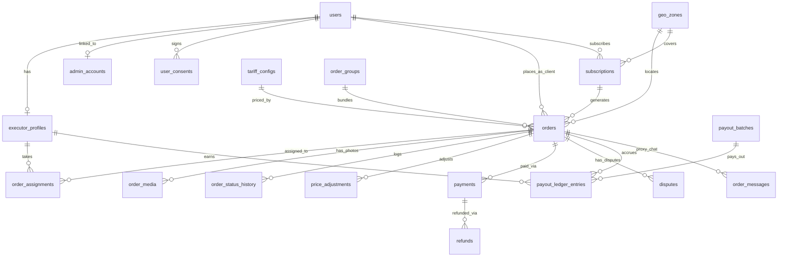
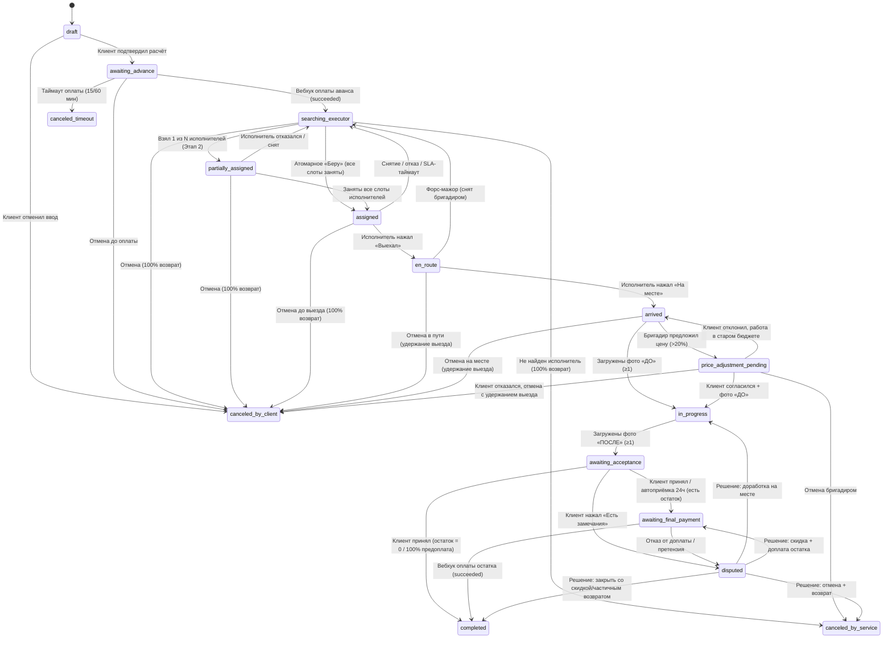

# Сервис «Снег-Диспетчер»: коммерческое предложение и техническое задание

**География запуска:** Малаховка · Томилино · Красково · Быково · Лыткарино (с расширением на Октябрьский, Люберцы)  
**Платформа:** мессенджер MAX (MAX Bot API `platform-api2.max.ru`)  
**Платёжный агрегатор:** ЮKassa (СБП + 54-ФЗ) + Mock-провайдер для локальной отладки  
**Версия документа:** 2.0 от 16.11.2026 *(доработано и расширено на базе v1.0; результаты аудита и ADR — в [`docs/00_audit_and_decisions.md`](./00_audit_and_decisions.md))*  
*Примечание: название «Снег-Диспетчер» рабочее, может быть изменено на бренд владельца с соблюдением правил нейминга MAX.*

---

## Содержание

- **Часть A. Коммерческое предложение**
  - [A1. Суть сервиса и цели сезона](#a1-суть-сервиса-и-цели-сезона)
  - [A2. Линейка услуг](#a2-линейка-услуг)
  - [A3. Конкурентные отличия](#a3-конкурентные-отличия)
  - [A4. Операционная и финансовая модель](#a4-операционная-и-финансовая-модель)
  - [A5. Тарифная логика (обзор)](#a5-тарифная-логика-обзор)
  - [A6. Юридические, налоговые и финансовые требования](#a6-юридические-налоговые-и-финансовые-требования)
  - [A7. Дорожная карта запуска](#a7-дорожная-карта-запуска)
  - [A8. Матрица рисков и мер митигации](#a8-матрица-рисков-и-мер-митигации)
- **Часть B. Техническое задание**
  - [B1. Цель, границы MVP и матрица этапов](#b1-цель-границы-mvp-и-матрица-этапов)
  - [B2. Роли и матрица прав доступа (RBAC)](#b2-роли-и-матрица-прав-доступа-rbac)
  - [B3. Платформа MAX Bot API, стек и архитектура](#b3-платформа-max-bot-api-стек-и-архитектура)
  - [B4. Доменная модель и схема базы данных](#b4-доменная-модель-и-схема-базы-данных)
  - [B5. Статусные машины и жизненный цикл сущностей](#b5-статусные-машины-и-жизненный-цикл-сущностей)
  - [B6. Сценарии MAX-бота и FSM-диалоги](#b6-сценарии-max-бота-и-fsm-диалоги)
  - [B7. Тарифный движок, геозоны, диспетчеризация, скидки и подписки](#b7-тарифный-движок-геозоны-диспетчеризация-скидки-и-подписки)
  - [B8. Внешние интеграции и контракты провайдеров](#b8-внешние-интеграции-и-контракты-провайдеров)
  - [B9. Спецификация HTTP API (FastAPI / OpenAPI 3.1)](#b9-спецификация-http-api-fastapi--openapi-31)
  - [B10. Веб-админ-панель и интерактивный веб-симулятор MAX-бота](#b10-веб-админ-панель-и-интерактивный-веб-симулятор-max-бота)
  - [B11. Фоновые задачи, таймеры и очереди (Redis + ARQ)](#b11-фоновые-задачи-таймеры-и-очереди-redis--arq)
  - [B12. Нефункциональные требования, безопасность и эксплуатация](#b12-нефункциональные-требования-безопасность-и-эксплуатация)
  - [B13. Конфигурация и переменные окружения](#b13-конфигурация-и-переменные-окружения)
  - [B14. Стратегия тестирования, критерии приёмки и DoD](#b14-стратегия-тестирования-критерии-приёмки-и-dod)

---

# Часть A. Коммерческое предложение

## A1. Суть сервиса и цели сезона

**«Снег-Диспетчер»** — автоматизированный сервис заказа уборки снега и бытовых/дворовых услуг в мессенджере MAX для жителей частного сектора, СНТ и коттеджных посёлков юго-востока Московской области.

**География работы (управляется через админ-панель):**
- **Ядро запуска (Зона 1):** Малаховка, Томилино.
- **Стартовое расширение (Зона 2, активна с запуска с настраиваемой ставкой выезда):** Красково, Быково, Лыткарино.
- **Масштабирование (Этап 4):** Октябрьский, Люберцы и прилегающие районы.

**Как это работает:** MAX-бот принимает заказ, рассчитывает ориентировочную стоимость по объёму работ, принимает авансовую оплату через СБП (ЮKassa с чеками 54-ФЗ), распределяет заказ среди бригады и подключённых исполнителей через общий диспетчерский чат с атомарной кнопкой **«Беру»**, фиксирует выполнение фотографиями **«до» и «после»** и закрывает финальный расчёт. Владелец-ИП выступает диспетчером и управляет тарифами, зонами, спорами и выплатами через веб-админку — бизнес масштабируется без раздувания штата.

**Цели первого сезона** *(заполняются владельцем перед стартом)*:
- Общее число выполненных заказов за сезон: **`[N]`** заказов;
- Число активных подписчиков на сезонную уборку: **`[N]`** клиентов;
- Медианное время от оплаты аванса до назначения исполнителя: **≤ 10 минут**;
- Доля спорных заказов (disputes): **< 5%**;
- Доля заказов, выполненных в согласованное окно: **≥ 90%**.

---

## A2. Линейка услуг

| № | Код (`service_type`) | Услуга | Параметры расчёта | Этап запуска |
|---|---|---|---|---|
| 1 | `snow_yard` | Уборка снега на участке и во дворе | Площадь (м²), глубина снега, ограничения подъезда, способ уборки (вручную / снегоуборщик или мини-погрузчик / трактор), срочность, выезд, опционально вывоз снега | Этап 1 (MVP) |
| 2 | `snow_road` | Расчистка дороги и проезда | Длина (м) × ширина (м) → площадь, далее по формуле уборки снега + выезд + вывоз снега | Этап 1 (MVP) |
| 3 | `car_rescue` | «Срочно застрял» (вытащить машину из сугроба) | Фиксированная базовая цена + надбавки за срочность, ночь и расстояние от базы | Этап 1 (MVP) |
| 4 | `yard_help` | Помощь по двору | Почасовая работа (от 2 часов), число исполнителей, техника (при необходимости), выезд | Этап 2 |
| 5 | `movers` | Грузчики на переезд | Почасовая работа (от 2 часов), число грузчиков, этаж и наличие лифта, техника/транспорт (опционально) | Этап 2 |
| 6 | `roof_cleaning` | Расчистка крыш | Площадь крыши, тип/уклон, наледь; **только допущенные и застрахованные исполнители** | Этап 4 |
| 7 | `reagents` | Посыпка реагентами | Площадь обработки × ставка (как допродажа к уборке без повторного выезда или отдельный заказ) | Этап 4 |

---

## A3. Конкурентные отличия

1. **Подписка на сезон (Этап 3).** Клиент оплачивает абонемент (месяц/сезон); при прогнозе снегопада от 5 см бот накануне отправляет уведомление: *«Ночью ожидается 15 см, выезжаем к 7:00, всё в силе?»*. Формирует предсказуемую регулярную выручку вместо охоты за разовыми заявками.
2. **Групповая цена для соседей (Этап 3).** Если на одной улице или в одном СНТ оформляется несколько заказов на один день, клиенты получают автоматическую скидку (например, 10–15%), а бригада экономит время и топливо на переездах.
3. **Обязательные фото «до» и «после» + двухэтапная оплата.** Аванс (30–50%) защищает от ложных вызовов; остаток клиент оплачивает после просмотра фотоотчёта «после». Число споров резко снижается.
4. **Ультракороткий сценарий «Срочно застрял».** Минимум шагов: геолокация → фото → цена → оплата СБП → ETA бригады. Самая маржинальная экстренная услуга максимально проста в стрессовой ситуации.
5. **Допродажи в сценарии заказа.** Посыпка реагентами, вывоз снега и (на Этапе 4) очистка крыш предлагаются на этапе расчёта.
6. **Биржа заказов для исполнителей.** Заказы публикуются в общий чат без точного адреса; кто первым нажал **«Беру»**, получает заказ и детали в личку. Позволяет быстро подключать самозанятых исполнителей и масштабироваться на соседние районы.

---

## A4. Операционная и финансовая модель

- **Клиент:** оформляет заказ в MAX-боте, оплачивает аванс по СБП, получает уведомления о статусах, принимает работу по фото «до/после» и оплачивает остаток.
- **Исполнитель (бригада / разнорабочий):** регистрируется в боте, принимает оферту, берёт заказы кнопкой «Беру», отмечает статусы, прикладывает фото «до» и «после», видит свой баланс начислений.
- **Бригадир:** обладает правами исполнителя + контролирует качество, инициирует корректировку цены на месте (при расхождении >20%), снимает/переназначает заказы, разбирает споры и обрабатывает эскалации.
- **Владелец (ИП) / Админ:** управляет тарифами, геозонами, допусками исполнителей, спорами, рассылками и реестром выплат через веб-админ-панель.

**Движение денег:**
- Клиент оплачивает аванс и остаток через **ЮKassa (СБП)** напрямую на расчётный счёт ИП с автоматической фискализацией чеков 54-ФЗ.
- После закрытия заказа (`completed`) система автоматически рассчитывает и записывает начисление исполнителю в финансовый реестр (`payout_ledger_entries`):
  - **Доля исполнителя:** по умолчанию `60–70%` от стоимости работ (настраивается глобально по услуге и индивидуально в профиле исполнителя);
  - **Компенсация выезда / техники:** настраиваемый % (например, 100% за выезд/топливо при работе на собственной технике);
  - **Бонусы:** надбавки за срочность / волну эскалации / ночной выезд;
  - **Штрафы:** удержания за подтверждённый срыв/неявку/нарушение регламента (начисляются админом/бригадиром с обязательной причиной).
- В рамках MVP выплаты исполнителям производятся владельцем вручную на основании реестра в админке с фиксацией реквизитов выплаты и номера/ссылки чека самозанятого (НПД).

---

## A5. Тарифная логика (обзор)

Все тарифы, коэффициенты, пороги автоподбора и проценты аванса хранятся в PostgreSQL (`tariff_configs`) и изменяются владельцем через веб-админку **без участия программиста**. Изменение тарифа создаёт новую версию — уже оформленные заказы сохраняют исходный снимок расчёта (`pricing_snapshot`).

- **Снег и дорога:**  
  `Итог = round50(max(min_order_total, max(min_work_price, площадь × ставка_способа × коэфф_глубины × коэфф_срочности) + выезд + вывоз_снега − групповая_скидка))`
  - Глубина: `≤ 10 см = 1.0`; `11–30 см = 1.5`; `> 30 см = 2.0`.
  - Способ уборки подбирается автоматически по площади, глубине и ширине подъезда (`manual` / `snowblower_or_miniloader` / `tractor`) с возможностью ручной смены.
  - Срочность: в течение дня = `1.0`; в течение 3 часов = `1.3`; «прямо сейчас» или ночь (`22:00–07:00` МСК) = `1.5`.
- **«Срочно застрял»:** фиксированная база + надбавки за срочность, ночь и километраж сверх бесплатного радиуса от базы, округление до 50 ₽.
- **Почасовые услуги и грузчики:** `ставка_в_час × число_людей × max(часы, 2) + доплата_за_этажи_без_лифта + техника + выезд`, округление до 50 ₽.
- **Крыши и реагенты:** площадь × отдельные ставки (с проверкой допуска и страховки исполнителя для крыш).
- **Точность оценки и перерасчёт >20%:** бот всегда обозначает расчётную сумму как *«ориентировочно»*. Если на месте бригадир фиксирует фактический объём/условия с отклонением цены **> 20%**, он отправляет новую цену через бота с фото-обоснованием; доплата применяется **исключительно после явного согласия клиента**. Подробные формулы, примеры и ветки отказа клиента — в разделе [B7](#b7-тарифный-движок-геозоны-диспетчеризация-скидки-и-подписки).

---

## A6. Юридические, налоговые и финансовые требования

*(Детали подлежат финальной сверке с бухгалтером и юристом владельца на Этапе 0)*

1. **Приём платежей и 54-ФЗ:** агрегатор **ЮKassa** (СБП, одностадийная оплата `capture: true`). Поскольку СБП в ЮKassa не поддерживает холдирование, оплата выполняется двумя отдельными платежами: аванс (`partial_prepayment`) и доплата (`full_payment` с зачётом аванса), либо 100% предоплата для подписок. Чек 54-ФЗ формируется на каждую операцию (включая возвраты).
2. **Отношения с исполнителями:** работа преимущественно с плательщиками НПД (самозанятыми) по оферте ГПХ, акцептуемой в боте (с логированием версии оферты, даты, `max_user_id`). При отметке выплаты в админке предусмотрено поле для URL/ID чека из «Мой налог».
3. **Персональные данные (152-ФЗ):** хранение БД и файлового хранилища строго на серверах в РФ. Раздельные явные согласия: (а) на обработку ПДн, (б) акцепт оферты, (в) отдельное согласие на передачу контактного номера исполнителю (с учётом ограничений `request_contact` в MAX).
4. **Охрана труда и страхование:** обязательный электронный чек-лист инструктажа по ТБ при регистрации; допуск к `roof_cleaning` и тяжёлой технике (`tractor`, `miniloader`) выдаётся только администратором после загрузки и проверки документов/страхового полиса (с контролем срока действия полиса).
5. **Отмена и возврат:** правила фиксируются в оферте клиента: до выезда исполнителя — возврат 100% аванса; после нажатия «Выехал» / «На месте» — удержание стоимости выезда (`dispatch_fee`), остаток аванса возвращается; при отмене по вине сервиса — возврат 100%.

---

## A7. Дорожная карта запуска

| Этап | Ориентировочный срок | Ключевой результат |
|---|---|---|
| **Этап 0. Фундамент** | 3–5 рабочих дней | Инфраструктура Docker Compose, сертификаты Минцифры, слоистый каркас FastAPI, актуальный клиент MAX Bot API (`platform-api2.max.ru`), схема БД и Alembic-миграции, интерфейс `PaymentProvider` + адаптер ЮKassa (тестовый магазин) + Mock, базовый веб-симулятор чатов MAX, `.env.example`, CI-тесты. |
| **Этап 1. MVP** | 2–3 недели | Полный цикл услуг `snow_yard`, `snow_road`, `car_rescue`: калькулятор, оплата аванса и остатка (ЮKassa СБП + Mock), общий чат бригады с атомарным «Беру», статусы и фотоотчёты «до/после» в S3, корректировка цены >20% бригадиром, веб-админка (заказы, тарифы, исполнители, споры, выплаты), полноценный веб-симулятор MAX для приёмки. |
| **Этап 2. Масштабирование** | 1–2 недели | Почасовые услуги (`yard_help`, `movers`), заказы на нескольких исполнителей (`required_executors > 1`), рейтинг и приоритет исполнителей, автоматические волны рассылки (топ → все → +бонус → эскалация бригадиру), штрафы и SLA-таймеры. |
| **Этап 3. Удержание и маржа** | 2 недели | Сезонные подписки с интеграцией `WeatherProvider` (прогноз осадков от 5 см, подтверждение выезда накануне), автоматическая кластеризация заказов по СНТ/улицам и групповые скидки для соседей. |
| **Этап 4. Расширение** | По плану развития | Крыши (`roof_cleaning`, контроль допусков/страховок), реагенты (`reagents`), допродажи, новые районы (Октябрьский, Люберцы), расширенная BI-аналитика, MAX Mini App с визуальным калькулятором на карте (`open_app`). |

*Сроки уточняются после завершения Этапа 0 и фиксации финального прайса/оферт.*

---

## A8. Матрица рисков и мер митигации

| Риск | Вероятность / Влияние | Технические и организационные меры |
|---|---|---|
| Увод клиентов исполнителями напрямую | Высокая / Высокое | В общем чате публикуется только район/СНТ и ориентировочная оплата; точный адрес, координаты и способ связи передаются в ЛС только после «Беру»; прокси-связь через бота; штраф в оферте; привязка клиента подпиской и историей. |
| Никто не берёт заказ на бирже | Средняя / Высокое | Автоматические волны рассылки (Этап 2), ступенчатое увеличение бонуса исполнителю, эскалация бригадиру через N минут (в MVP — через 10 мин), ручное назначение из админки. |
| Пиковая нагрузка в сильный снегопад | Высокая / Высокое | Асинхронный FastAPI + очередь ARQ + Redis, rate-limiter под лимиты MAX (30 RPS / 2 msg/s per chat), нагрузочный тест перед сезоном, мониторинг и авто-алерты владельцу. |
| Споры по объёму и качеству работ | Средняя / Среднее | Обязательные фото «до» и «после» с хранением в S3, явная пометка «ориентировочно», регламент перерасчёта >20% только с согласия клиента, модуль споров для бригадира. |
| Травмы, порча имущества | Низкая / Критическое | Цифровой чек-лист инструктажа, обязательный допуск + полис страхования с контролем даты окончания для `roof_cleaning` и тяжёлой техники. |
| Изменения / модерация MAX | Средняя / Высокое | Весь MAX API изолирован за интерфейсом `MessengerTransport`; соблюдение актуальных требований 2026 года (`platform-api2.max.ru`, сертификат Минцифры, HTTPS Webhook, правила `request_contact`, реквизиты и юр. страницы на сайте). |
| Рассинхрон статусов оплаты СБП | Низкая / Высокое | Идемпотентность всех платежей (`Idempotence-Key`), двойная проверка вебхуков ЮKassa (IP allowlist + обратный `GET /v3/payments/{id}`), ночная cron-сверка зависших платежей. |

---

# Часть B. Техническое задание

## B1. Цель, границы MVP и матрица этапов

**Цель:** разработать и ввести в эксплуатацию программный комплекс «Снег-Диспетчер», состоящий из:
1. MAX-бота для клиентов, исполнителей и бригадиров;
2. Бэкенд-сервиса (FastAPI) и фоновых воркеров (ARQ + Redis);
3. Базы данных (PostgreSQL + Alembic) и S3-хранилища фотоотчётов в РФ;
4. Веб-админ-панели для владельца, администраторов и бригадиров;
5. Интерактивного веб-симулятора MAX-бота и Mock-шлюза оплаты для сквозного тестирования и приёмки в браузере без токена MAX и реальных платежей.

**Вне границ MVP (Этап 1):**
- Автоматические денежные выплаты исполнителям через API банков/ЮKassa Payouts (в MVP — реестр начислений + ручная выплата с отметкой в админке);
- Нативные мобильные приложения (iOS/Android);
- Прямая интеграция с 1С / бухгалтерией;
- ИИ-оценка площади и глубины снега по фото;
- MAX Mini App (закладывается кнопка `open_app` на Этап 4).

### Матрица распределения функциональности по этапам

| Функциональный блок | Этап 0 | Этап 1 (MVP) | Этап 2 | Этап 3 | Этап 4 |
|---|:---:|:---:|:---:|:---:|:---:|
| Каркас слоёв, Docker Compose, сертификат Минцифры, CI | ✅ | ✅ | ✅ | ✅ | ✅ |
| Схема БД (полный каркас с `order_assignments`, `geo_zones`, `tariffs`) | ✅ | ✅ | ✅ | ✅ | ✅ |
| MAX Bot API клиент (`platform-api2.max.ru`) + `SimulatorTransport` | ✅ | ✅ | ✅ | ✅ | ✅ |
| `PaymentProvider`: ЮKassa СБП + 54-ФЗ + `MockPaymentProvider` | ✅ (тест) | ✅ (боевой) | ✅ | ✅ | ✅ |
| Услуги `snow_yard`, `snow_road`, `car_rescue` + калькулятор | — | ✅ | ✅ | ✅ | ✅ |
| Общий чат биржи с атомарным «Беру» + ЛС исполнителя + фото до/после | — | ✅ | ✅ | ✅ | ✅ |
| Корректировка цены >20% бригадиром + базовые споры | — | ✅ | ✅ | ✅ | ✅ |
| Веб-админка (заказы, тарифы, зоны, исполнители, споры, выплаты) | базовая | ✅ | ✅ | ✅ | ✅ |
| Интерактивный веб-симулятор MAX-бота (мультичат) | базовый | ✅ | ✅ | ✅ | ✅ |
| Почасовые услуги (`yard_help`, `movers`), `required_executors > 1` | — | — | ✅ | ✅ | ✅ |
| Рейтинги, волны рассылки, авто-бонус, штрафы | — | — | ✅ | ✅ | ✅ |
| Сезонные подписки + `WeatherProvider` (прогноз ≥ 5 см) | — | — | — | ✅ | ✅ |
| Групповые скидки соседей (кластеризация по СНТ/улице/дню) | — | — | — | ✅ | ✅ |
| `roof_cleaning`, `reagents`, допродажи, BI-отчёты, MAX Mini App | — | — | — | — | ✅ |

---

## B2. Роли и матрица прав доступа (RBAC)

В системе предусмотрены 5 ролей. Пользователь MAX идентифицируется по `max_user_id`; доступ в веб-админку предоставляется отдельным учётным записям (`admin_accounts`) с ролями `owner`, `admin`, `foreman` (с привязкой к `max_user_id` для синхронных уведомлений).

| Действие | Клиент (`client`) | Исполнитель (`executor`) | Бригадир (`foreman`) | Админ (`admin`) | Владелец (`owner`) |
|---|:---:|:---:|:---:|:---:|:---:|
| Создание, оплата, отмена, история своих заказов | ✅ | ✅ *(как клиент)* | ✅ *(как клиент)* | ✅ | ✅ |
| Оформление и управление своей подпиской (Этап 3) | ✅ | ✅ | ✅ | ✅ | ✅ |
| Просмотр ленты биржи и атомарное нажатие «Беру» | ❌ | ✅ *(верифицирован)* | ✅ | ❌ | ❌ |
| Просмотр точного адреса и контакта клиента | только свой | только взятый заказ | все активные | ✅ | ✅ |
| Смена статусов исполнения, загрузка фото «до/после» | ❌ | только свой заказ | любой заказ | ✅ | ✅ |
| Просмотр собственного баланса и начислений | ❌ | ✅ | ✅ | ✅ | ✅ |
| Запрос корректировки цены >20% на объекте | ❌ | запросить у бригадира | ✅ *(отправить клиенту)* | ✅ | ✅ |
| Снятие и переназначение исполнителя на заказе | ❌ | отказ со штрафом/причиной | ✅ | ✅ | ✅ |
| Разбор спора (`disputed`): доработка / скидка / отмена | ❌ | ❌ | ✅ *(в пределах лимита)* | ✅ | ✅ |
| Вход в веб-админку | ❌ | ❌ | ✅ *(ограниченный)* | ✅ | ✅ |
| Верификация исполнителей, выдача допусков (крыши/техника) | ❌ | ❌ | просмотр | ✅ | ✅ |
| Редактирование тарифов, коэффициентов и геозон | ❌ | ❌ | ❌ | ✅ | ✅ |
| Возвраты средств (refund) в ЮKassa | ❌ | ❌ | ❌ | ✅ | ✅ |
| Создание и проведение реестра выплат (фиксация НПД-чеков) | ❌ | ❌ | ❌ | ✅ | ✅ |
| Управление ролями админов, блокировка пользователей, рассылки | ❌ | ❌ | ❌ | частично | ✅ |

---

## B3. Платформа MAX Bot API, стек и архитектура

### B3.1. Актуальные требования MAX Bot API (сверено по `dev.max.ru`, ноябрь 2026)

Разработчик **обязан** использовать актуальный контракт MAX Bot API (устаревшие домены `botapi.max.ru` и `platform-api.max.ru`, а также query-токен и `GET /chats` не применяются):

1. **Базовый URL:** `https://platform-api2.max.ru` (конфигурируется через `MAX_API_BASE_URL`).
2. **Сертификат Минцифры РФ:** корневой и промежуточный сертификаты Минцифры РФ (`Russian Trusted Root CA`, `Russian Trusted Sub CA`) обязательно добавляются в системный trust store Docker-образов и передаются в `httpx` SSL context.
3. **Авторизация:** исключительно HTTP-заголовок `Authorization: <MAX_BOT_TOKEN>` (без префикса `Bearer`, строго по документации `dev.max.ru`).
4. **Доставка событий:**
   - **Production:** только **Webhook** (`POST /subscriptions`) по **HTTPS** с валидным доверенным TLS-сертификатом (самоподписные запрещены с 25.05.2026). Обязательно задаётся `secret` (`^[a-zA-Z0-9_-]{5,256}$`), который проверяется в заголовке `X-Max-Bot-Api-Secret` на каждом входящем POST-запросе. Подписываемые события: `bot_started`, `bot_stopped`, `bot_added`, `bot_removed`, `message_created`, `message_callback`, `message_edited`, `user_added`, `user_removed`.
   - **Локальная разработка:** допустим Long Polling (`GET /updates?marker=...&timeout=30`) при отсутствии активной webhook-подписки, либо встроенный **Веб-симулятор MAX** (`SimulatorTransport`).
5. **Групповой чат бригады (`chat_id`):** метод `GET /chats` удалён в июне 2026. Бот должен быть добавлен в групповой чат исполнителей **администратором** (минимальные права: `read_all_messages`, `write`, опционально `pin_message`). При событии `bot_added` (или команде привязки `/bind_dispatch_chat`) система сохраняет `chat_id` в таблицу `bot_chats` и позволяет выбрать его в админке как активный чат биржи.
6. **Отправка, редактирование и callback-ответы:**
   - Отправка в ЛС: `POST /messages?user_id={user_id}`;
   - Отправка в групповой чат: `POST /messages?chat_id={chat_id}`;
   - Редактирование сообщения (например, карточки заказа в общем чате после «Беру»): `PUT /messages?message_id={mid}` (сообщения с `inline_keyboard` и любые сообщения в групповых чатах редактируются без ограничения 7 суток);
   - Ответ на нажатие кнопки (`message_callback`): `POST /answers?callback_id={callback_id}` — позволяет мгновенно показать одноразовое `notification` (например, «Заказ уже забрал другой исполнитель») и/или атомарно обновить сообщение.
7. **Клавиатуры (`attachments[].type = "inline_keyboard"`):**
   - Максимум 30 рядов, до 7 кнопок в ряду (`callback`, `message`, `clipboard`), **не более 3 кнопок в ряду** для `link`, `open_app`, `request_geo_location`, `request_contact`;
   - `callback.payload` — до 1024 символов; рекомендуемая длина `text` кнопки — до 20 символов при 1 кнопке в ряду и до 10 символов при 2 кнопках в ряду;
   - Текст сообщения — до 4000 символов, формат `markdown` или `html`.
8. **Загрузка и приём медиафайлов:**
   - Отправка изображений ботом: `POST /uploads?type=image` (значение `type=photo` удалено!) → multipart/resumable upload на возвращённый `url` → передача `token` в `attachments: [{type: "image", payload: {token}}]`. Обязателен retry с backoff (0.5с, 1с, 2с, 4с) на ошибку `attachment.not.ready`.
   - Приём фото от клиентов и исполнителей: из `message.body.attachments` с `type == "image"` извлекаются `photo_id`, `token`, `url`; воркер скачивает файл по `url` (с проверкой MIME и размера до 20 МБ) и сохраняет в S3-хранилище в РФ.
9. **Rate Limits MAX:**
   - Глобальный лимит: **≤ 30 RPS** на `platform-api2.max.ru` (настраиваем клиентский лимитер на 25 RPS с запасом);
   - Per-chat лимит: **≤ 2 запроса/сек** на отправку/редактирование в один диалог или групповой чат (реализуется через Redis token bucket в слое уведомлений).
10. **Политика контактов (`request_contact`):**
    - Согласно документации MAX, телефон, полученный через `request_contact` (включая проверку `hash`), разрешается использовать **только для взаимодействия внутри текущего чат-бота**.
    - Поэтому: (а) `request_contact` используется для верификации аккаунта в боте и фискального чека (если клиент подтвердил), (б) для связи между клиентом и исполнителем по умолчанию работает **анонимный прокси-чат через бота** («Написать клиенту» / «Написать исполнителю»), а при желании клиента созвониться напрямую бот запрашивает номер **отдельным текстовым шагом** с явным согласием на передачу исполнителю (152-ФЗ).

### B3.2. Технологический стек

| Слой | Технология | Обоснование |
|---|---|---|
| Язык и рантайм | Python 3.12+ | Современная типизация, высокая скорость asyncio |
| Web / API фреймворк | FastAPI + Uvicorn / Gunicorn | Нативный OpenAPI 3.1, Pydantic v2, async |
| ORM и миграции | SQLAlchemy 2.0 (asyncpg) + Alembic | Строгие транзакции (`SELECT FOR UPDATE`), воспроизводимые миграции |
| БД | PostgreSQL 16 (с расширением `pg_trgm`; опционально PostGIS на Этапе 3+) | ACID, JSONB, надёжная конкурентность |
| Кэш, FSM, очереди | Redis 7 + ARQ | Хранение FSM-состояний, rate-limiter, отложенные задачи и cron |
| Файловое хранилище | S3-совместимое хранилище в РФ (Yandex Object Storage / Selectel / MinIO в dev) | Надёжное хранение фотоотчётов в РФ |
| HTTP-клиент | `httpx` (async) | Поддержка custom SSL trust store (Минцифры), таймауты, пулы |
| Веб-админка и симулятор | SPA (React + TypeScript + Vite) или серверные шаблоны + HTMX/Tailwind *(общается строго через `/api/v1/admin/*` и `/api/v1/simulator/*`)* | Чёткое отделение UI от бизнес-логики |
| Инфраструктура | Docker Compose, nginx (HTTPS + Let's Encrypt / доверенный TLS), сервер в РФ | Простое развёртывание и перенос |
| Тесты и качество | `pytest`, `pytest-asyncio`, `httpx.AsyncClient`, `ruff`, `mypy` | Автоматическая проверка расчётов, конкурентности и API |

### B3.3. Слоистая архитектура проекта

```text
sneg/
├── src/
│   ├── core/                # config (pydantic-settings), logging, security, exceptions, db, redis
│   ├── domain/              # Чистая бизнес-логика (не зависит от HTTP/MAX/ЮKassa)
│   │   ├── pricing/         # Калькулятор тарифов (Decimal), автоподбор техники, скидки
│   │   ├── orders/          # Статусная машина, валидация переходов, расчёт возвратов
│   │   ├── dispatch/        # Атомарный захват «Беру», волны рассылки, эскалации
│   │   ├── payouts/         # Расчёт доли исполнителя, бонусов, штрафов
│   │   └── geo/             # Определение геозоны, Haversine, кластеры СНТ/улиц
│   ├── infra/               # Реализации хранилищ и БД
│   │   ├── db/              # SQLAlchemy модели, репозитории, Alembic migrations
│   │   ├── storage/         # Интерфейс FileStorage + S3Storage + LocalFileStorage
│   │   └── queue/           # ARQ worker, расписание cron, retry-политики
│   ├── services/            # Интеграции за абстрактными протоколами (Protocol/ABC)
│   │   ├── messenger/       # MessengerTransport: MaxApiClient + SimulatorTransport
│   │   ├── payments/        # PaymentProvider: YooKassaProvider + MockPaymentProvider
│   │   ├── weather/         # WeatherProvider: OpenMeteoProvider + MockWeatherProvider
│   │   └── notifications/   # Rate-limited отправка уведомлений (2 msg/s per chat, 25 RPS)
│   ├── bot/                 # Обработчики событий MAX (единые для MAX API и Симулятора!)
│   │   ├── router.py        # Маршрутизация Update (bot_started, message_created, message_callback)
│   │   ├── fsm.py           # Машина диалоговых состояний в Redis (TTL + сериализация)
│   │   ├── keyboards/       # Фабрики inline-клавиатур с проверкой ограничений MAX
│   │   └── handlers/        # client/, executor/, foreman/, dispatch_chat/, proxy_chat/
│   ├── api/                 # FastAPI роутеры
│   │   ├── webhooks/        # /webhooks/max, /webhooks/yookassa
│   │   ├── admin/           # /api/v1/admin/* (RBAC JWT/cookie)
│   │   ├── simulator/       # /api/v1/simulator/* + WebSocket (только при ENABLE_SIMULATOR=true)
│   │   └── mock_pay/        # /mock-pay/* (только при PAYMENT_PROVIDER=mock)
│   └── main.py              # Точка входа FastAPI + lifespan
├── web/                     # Фронтенд веб-админки и интерактивного симулятора MAX-бота
├── tests/                   # unit/, integration/, e2e/
├── docker/                  # Dockerfile (с сертификатами Минцифры), nginx.conf
├── docker-compose.yml
├── .env.example
└── docs/                    # КП, ТЗ, аудит, DDL-схема БД
```

**Ключевой архитектурный принцип:** веб-симулятор MAX-бота **не дублирует** бизнес-логику бота — он формирует стандартные объекты `Update` (в точном формате MAX Bot API) и передаёт их в тот же `bot/router.py`, а `bot/handlers` отвечают через `MessengerTransport` (`SimulatorTransport` вместо `MaxApiClient`). Это гарантирует идентичность поведения в симуляторе и в реальном MAX.

---

## B4. Доменная модель и схема базы данных

Эталонный DDL-скрипт для первой миграции Alembic вынесен в отдельный файл [`docs/02_database_schema.sql`](./02_database_schema.sql). Все денежные поля имеют тип `NUMERIC(12, 2)`, все временные метки — `TIMESTAMPTZ` (хранение в UTC, отображение в `Europe/Moscow`).

### B4.1. ER-диаграмма основных сущностей



### B4.2. Описание таблиц БД

| Таблица | Назначение | Ключевые поля и ограничения |
|---|---|---|
| `users` | Все пользователи MAX-бота (клиенты, исполнители, бригадиры) | `id (UUID PK)`, `max_user_id (BIGINT UNIQUE NOT NULL)`, `max_chat_id (BIGINT)`, `username`, `first_name`, `last_name`, `role (user_role)`, `bot_phone` *(только из `request_contact` — строго для бота!)*, `shared_contact_phone` *(введён вручную с согласием)*, `email` *(для чеков 54-ФЗ)*, `is_blocked`, `created_at` |
| `user_consents` | Журнал юридических согласий (152-ФЗ, оферта, передача телефона) | `id`, `user_id (FK)`, `consent_type` (`pdn`, `client_offer`, `executor_offer`, `phone_transfer`, `safety_briefing`), `document_version`, `accepted_at`, `source` |
| `executor_profiles` | Профиль исполнителя / бригадира | `user_id (PK, FK)`, `status` (`pending_verification`, `active`, `suspended`, `blocked`), `is_self_employed`, `inn`, `share_pct_override (NUMERIC(5,2))`, `max_active_orders (INT DEFAULT 1)`, `rating (NUMERIC(3,2))`, `completed_orders_count`, `canceled_orders_count`, `has_snowblower`, `has_miniloader`, `has_tractor`, `roof_certified`, `insurance_policy_no`, `insurance_valid_until`, `verified_by`, `verified_at` |
| `admin_accounts` | Учётные записи веб-админ-панели | `id`, `email (UNIQUE)`, `password_hash (Argon2id)`, `role` (`owner`, `admin`, `foreman`), `linked_user_id (FK users)`, `is_active`, `last_login_at` |
| `bot_chats` | Реестр групповых чатов MAX (замена удалённому `GET /chats`) | `chat_id (BIGINT PK)`, `title`, `chat_purpose` (`dispatch_pool`, `foreman_alerts`, `other`), `is_active`, `bot_is_admin`, `added_at` |
| `geo_zones` | Геозоны обслуживания и тарифы выезда | `id`, `code (UNIQUE)`, `name`, `tier` (`core`, `extended`, `planned`), `is_active`, `dispatch_fee`, `base_lat`, `base_lon`, `polygon_geojson (JSONB)`, `free_radius_km`, `per_km_rate` |
| `tariff_configs` | Версионируемые настройки тарифов и коэффициентов | `id`, `version (INT UNIQUE)`, `is_active (BOOL)` *(partial unique index `WHERE is_active = true`)*, `config_json (JSONB)` *(все ставки, коэфф. глубины/срочности, пороги автоподбора, доли исполнителей, % аванса, ночные часы, штрафы, скидки)*, `updated_by`, `created_at` |
| `order_groups` | Группировка соседских заказов (Этап 3) | `id`, `service_date (DATE)`, `geo_zone_id (FK)`, `cluster_key` *(СНТ/улица)*, `orders_count`, `discount_pct`, `status` |
| `subscriptions` | Сезонные подписки (Этап 3) | `id`, `client_id (FK)`, `geo_zone_id (FK)`, `plan_type` (`monthly`, `season`), `status` (`pending_payment`, `active`, `paused`, `expired`, `canceled`), `address_text`, `lat`, `lon`, `area_m2`, `cleaning_method`, `access_constraint`, `snow_trigger_cm (DEFAULT 5)`, `preferred_time_window`, `price_paid`, `starts_at`, `ends_at`, `auto_confirm_hours` |
| `orders` | Центральная сущность заказа | `id (UUID PK)`, `public_number (BIGSERIAL UNIQUE — человекочитаемый № заказа)`, `client_id (FK)`, `service_type`, `status (order_status)`, `payment_status`, `geo_zone_id (FK)`, `subscription_id (FK NULL)`, `order_group_id (FK NULL)`, `address_text`, `public_area_hint` *(для общего чата без точного адреса!)*, `lat`, `lon`, `distance_from_base_km`, `params_json (JSONB)` *(площадь, глубина, длина/ширина, часы, этажи, подъезд, вывоз)*, `cleaning_method`, `urgency`, `required_executors (INT DEFAULT 1)`, `scheduled_for (TIMESTAMPTZ)`, `tariff_config_id (FK)`, `pricing_snapshot (JSONB NOT NULL)`, `estimated_total`, `final_total`, `advance_amount`, `paid_amount`, `group_discount_amount`, `executor_bonus_amount`, `dispatch_wave (INT DEFAULT 0)`, `dispatch_chat_id`, `dispatch_message_id` *(mid в MAX для редактирования)*, `contact_mode` (`bot_proxy`, `direct_phone`), `client_comment`, `created_at`, `updated_at`, `completed_at` |
| `order_assignments` | Назначения исполнителей на заказ (M:N, с Этапа 0) | `id`, `order_id (FK)`, `executor_id (FK)`, `role_in_order` (`primary`, `helper`), `status` (`assigned`, `en_route`, `arrived`, `in_progress`, `completed`, `released_by_executor`, `removed_by_foreman`), `executor_share_pct`, `accepted_at`, `en_route_at`, `arrived_at`, `started_at`, `finished_at`, `UNIQUE(order_id, executor_id)` *(с partial index для активных)* |
| `order_media` | Фотографии заказа (клиента, «ДО», «ПОСЛЕ», перерасчёт, спор) | `id`, `order_id (FK)`, `uploaded_by (FK users)`, `stage` (`client_problem`, `before`, `after`, `price_adjustment`, `dispute`), `storage_key` *(ключ в S3)*, `max_photo_id`, `max_token`, `mime_type`, `size_bytes`, `sha256`, `created_at` |
| `price_adjustments` | Корректировки цены на месте (>20%) | `id`, `order_id (FK)`, `proposed_by (FK users)`, `old_total`, `new_total`, `delta_pct`, `reason`, `status` (`pending`, `approved`, `rejected`, `expired`), `client_responded_at`, `expires_at`, `created_at` |
| `payments` | Все входящие платежи (аванс, доплата, подписка) | `id (UUID PK)`, `order_id (FK NULL)`, `subscription_id (FK NULL)`, `purpose` (`advance`, `final`, `full_prepayment`, `subscription`), `provider` (`yookassa`, `mock`), `provider_payment_id (UNIQUE)`, `idempotency_key (UUID UNIQUE NOT NULL)`, `amount`, `currency ('RUB')`, `status` (`pending`, `succeeded`, `canceled`), `confirmation_url`, `receipt_status`, `expires_at`, `paid_at`, `raw_response (JSONB)`, `created_at` |
| `refunds` | Возвраты платежей | `id`, `payment_id (FK)`, `order_id (FK)`, `provider_refund_id (UNIQUE)`, `idempotency_key (UUID UNIQUE)`, `amount`, `reason`, `status` (`pending`, `succeeded`, `canceled`), `initiated_by`, `created_at`, `succeeded_at` |
| `disputes` | Споры и рекламации по заказам | `id`, `order_id (FK)`, `opened_by (FK)`, `assigned_to (FK admin/foreman)`, `reason`, `status` (`open`, `in_review`, `resolved_rework`, `resolved_discount`, `resolved_refund`, `rejected`), `resolution_note`, `refund_amount`, `created_at`, `resolved_at` |
| `payout_ledger_entries` | Финансовый леджер начислений/удержаний исполнителей | `id`, `executor_id (FK)`, `order_id (FK NULL)`, `entry_type` (`order_earning`, `dispatch_compensation`, `urgency_bonus`, `penalty`, `manual_adjustment`), `amount` *(со знаком +/-)*, `status` (`accrued`, `included_in_batch`, `paid`, `voided`), `payout_batch_id (FK NULL)`, `comment`, `created_at` |
| `payout_batches` | Реестр фактических выплат исполнителям | `id`, `executor_id (FK)`, `total_amount`, `status` (`draft`, `paid`), `payment_method_note`, `npd_receipt_url`, `npd_receipt_id`, `paid_by (FK admin_accounts)`, `paid_at`, `created_at` |
| `order_status_history` | Неизменяемый аудит переходов статусов заказа | `id`, `order_id (FK)`, `from_status`, `to_status`, `actor_user_id`, `actor_admin_id`, `reason`, `meta_json`, `created_at` |
| `order_messages` | Прокси-переписка клиента и исполнителя через бота | `id`, `order_id (FK)`, `sender_user_id`, `recipient_user_id`, `text`, `created_at` |
| `processed_webhook_events` | Идемпотентность входящих вебхуков MAX и ЮKassa | `id`, `source` (`max`, `yookassa`), `event_key (UNIQUE)`, `received_at` |
| `audit_logs` | Журнал действий администраторов в веб-админке | `id`, `admin_id (FK)`, `action`, `entity_type`, `entity_id`, `diff_json (JSONB)`, `ip_address`, `created_at` |
| `simulator_messages` | Сообщения и состояние интерактивного веб-симулятора MAX *(только dev/stage)* | `id`, `chat_id`, `chat_type` (`dialog`, `group`), `sender_role`, `sender_max_user_id`, `max_message_id`, `text`, `attachments_json`, `is_edited`, `created_at` |

---

## B5. Статусные машины и жизненный цикл сущностей

### B5.1. Диаграмма состояний заказа (`orders.status`)



### B5.2. Матрица допустимых переходов заказа и side-effects

| Из статуса | В статус | Допустимые акторы | Условие (Guard) | Обязательные Side-effects |
|---|---|---|---|---|
| `draft` | `awaiting_advance` | `client` | Все обязательные поля + согласия заполнены | Фиксация `pricing_snapshot`, создание платежа аванса в `PaymentProvider`, постановка таймера `order_payment_timeout` в ARQ |
| `awaiting_advance` | `searching_executor` | `system` (webhook ЮKassa/Mock) | Подтверждённый `GET /payments/{id} == succeeded`, сумма совпадает | `payment_status = advance_paid`, публикация карточки в общий чат (без точного адреса!), сохранение `dispatch_message_id`, запуск `dispatch_wave_timer` |
| `awaiting_advance` | `canceled_timeout` | `system` (ARQ) | Не оплачен за 15 мин (`car_rescue`) / 60 мин (остальные) | Отмена платежа (если pending), уведомление клиента |
| `searching_executor` / `partially_assigned` | `partially_assigned` / `assigned` | `executor`, `foreman` | В транзакции `FOR UPDATE`: исполнитель `active`, не превышен `max_active_orders`, есть допуск (для крыш/техники), `assigned < required_executors` | Создание `order_assignments`, редактирование карточки в общем чате (`PUT /messages` — убрать кнопку «Беру» когда слоты заполнены), отправка точного адреса/гео в ЛС исполнителю, уведомление клиента, запуск SLA-таймера `executor_en_route_timeout` (15 мин) |
| `assigned` | `searching_executor` | `foreman`, `admin`, `system` (SLA) | Исполнитель отказался, снят или не нажал «Выехал» за 15 мин | Обновление `order_assignments.status`, опционально запись штрафа, перепубликация в общий чат, алерт бригадиру |
| `assigned` | `en_route` | `executor`, `foreman` | Исполнитель назначен на заказ | `en_route_at = now()`, уведомление клиента с ETA |
| `en_route` | `arrived` | `executor`, `foreman` | — | `arrived_at = now()`, уведомление клиента, запрос у исполнителя фото «ДО» |
| `arrived` | `price_adjustment_pending` | `foreman`, `admin` | `abs(new_total - estimated_total) / estimated_total > 0.20` (или любое изменение с причиной) + ≥1 фото обоснования | Создание `price_adjustments` (TTL 30 мин), отправка клиенту карточки с кнопками «Согласен» / «Отказаться» |
| `arrived` / `price_adjustment_pending` | `in_progress` | `executor`, `foreman` | Загружено **≥ 1 фото стадии `before`**; нет активного `price_adjustment` в `pending` | `started_at = now()`, пересылка фото «ДО» клиенту |
| `in_progress` | `awaiting_acceptance` | `executor`, `foreman` | Загружено **≥ 1 фото стадии `after`** | `finished_at = now()`, отправка клиенту фото «ПОСЛЕ» + кнопки «Принять работу» / «Есть замечания», запуск таймера автоприёмки (24 ч) |
| `awaiting_acceptance` | `awaiting_final_payment` | `client`, `system` (24ч) | `final_total - paid_amount > 0` | Создание платежа остатка в `PaymentProvider` (чек `full_payment` с зачётом аванса), отправка ссылки СБП клиенту |
| `awaiting_acceptance` / `awaiting_final_payment` | `completed` | `system` (webhook), `client` (если остаток 0), `admin` | `paid_amount == final_total` | `payment_status = fully_paid`, `completed_at = now()`, автоматическое начисление в `payout_ledger_entries` для каждого назначенного исполнителя, запрос оценки 1–5 у клиента |
| `awaiting_acceptance` / `awaiting_final_payment` | `disputed` | `client`, `foreman`, `admin` | Указана причина спора | Создание записи в `disputes`, заморозка автоприёмки и начислений, мгновенный алерт бригадиру и админу |
| `searching_executor` / `assigned` / `en_route` / `arrived` | `canceled_by_client` | `client`, `admin` | — | Если до `en_route`: возврат 100% аванса (`refunds`); если `en_route`/`arrived`: удержание `min(paid_amount, dispatch_fee)` (компенсация выезда исполнителю), возврат разницы; снятие карточки из общего чата |

*Любой переход, отсутствующий в матрице, обязан отклоняться доменным сервисом с ошибкой `InvalidStateTransitionError` (HTTP 409).*

---

## B6. Сценарии MAX-бота и FSM-диалоги

FSM-состояние хранится в Redis по ключу `fsm:{max_user_id}` (JSON с `state`, `data`, `updated_at`, TTL = 6 часов) с возможностью возврата на шаг назад («← Назад») и сброса («Главное меню» / `/start`).

### B6.1. Стартовое меню и онбординг клиента

1. Пользователь открывает бота (`bot_started`, возможен `payload` диплинка, например `ref_snt_malakhovka` или `urgent_car`).
2. Если пользователь новый:
   - Приветствие сервиса, краткое описание географии (Малаховка, Томилино, Красково, Быково, Лыткарино).
   - Ссылки на Публичную оферту и Политику ПДн (`link`-кнопки на сайт владельца) + callback-кнопка **«Принимаю условия»** (фиксирует `pdn` и `client_offer` в `user_consents`).
   - Опциональная кнопка `request_contact` **«Подтвердить аккаунт»** *(номер сохраняется в `bot_phone`, НЕ передаётся исполнителю — строго по правилам MAX)*.
3. **Главное меню клиента** (`inline_keyboard`):
   - Ряд 1: `[🚨 Срочно застрял]` *(акцентная кнопка вверху!)*
   - Ряд 2: `[❄️ Убрать снег во дворе]` `[🛣 Расчистить дорогу]`
   - Ряд 3: `[🧹 Помощь по двору]` `[📦 Грузчики]` *(Этап 2; на Этапе 1 скрыты или пометка «Скоро»)*
   - Ряд 4: `[📅 Подписка на сезон]` *(Этап 3)* `[📋 Мои заказы]`
   - Ряд 5: `[👷 Стать исполнителем]` `[❓ Помощь / Оферта]`

### B6.2. Сценарий 1: «Уборка снега во дворе» (`snow_yard`) и «Расчистка дороги» (`snow_road`)

| Шаг | Состояние FSM | Ввод клиента | Действия бота и валидация |
|---|---|---|---|
| 1 | `order:geo` | Геолокация (`request_geo_location`) ИЛИ текст адреса | Проверка попадания в активную `geo_zone`. Если вне зоны — вежливый отказ + кнопка «Оставить заявку на расширение». Определение `public_area_hint` (напр., «Малаховка, р-н Красковского ш.») без номера дома. |
| 2 | `order:address_details` | Текст: улица/СНТ, дом, ориентир, ворота | Сохранение точного `address_text` (скрыт до «Беру»). |
| 3 | `order:dimensions` | Для `snow_yard`: площадь в м² (быстрые кнопки `50`, `100`, `200`, `300` м² + ручной ввод `[10..10000]`). Для `snow_road`: длина (м) и ширина (м). | Валидация чисел; расчёт `area_m2`. |
| 4 | `order:depth` | Кнопки: `До 10 см` / `10–30 см` / `Больше 30 см` | Выбор `depth_bucket` (`1.0` / `1.5` / `2.0`). |
| 5 | `order:access` | Кнопки: `Узкая калитка (только ручная/малая)` / `Ворота (мини-погрузчик)` / `Широкий проезд (трактор)` | Автоподбор рекомендуемого `cleaning_method` + кнопка «Изменить способ». |
| 6 | `order:urgency` | Кнопки: `В течение дня (×1.0)` / `До 3 часов (×1.3)` / `Прямо сейчас / Ночь (×1.5)` | Если текущее время в `22:00–07:00` МСК и выбран «прямо сейчас», применяется ночной коэффициент `1.5`. |
| 7 | `order:extras` | Кнопки: `Вывоз снега: Нет / Да`, опционально прикрепить 1–3 фото участка, комментарий | На Этапе 4 добавляются кнопки допродажи «Посыпка реагентами» и «Крыша». |
| 8 | `order:contact_mode` | Кнопки: `Связь через чат бота (без номера)` / `Указать телефон для звонка бригады` | Если выбран звонок — ввод номера текстом + фиксация согласия `phone_transfer` (152-ФЗ). Также запрос `email` или телефона для чека 54-ФЗ (если ещё не сохранён). |
| 9 | `order:confirm` | Экран расчёта с детальной сметой | Показ: способ, площадь, глубина, выезд, вывоз, групповая скидка (если нашлась на Этапе 3), **«Ориентировочная стоимость: X ₽»**, «Аванс (30%): Y ₽», «Остаток после фотоотчёта: Z ₽», предупреждение о перерасчёте при расхождении >20%. Кнопки: `[💳 Оплатить аванс Y ₽ (СБП)]`, `[✏️ Изменить]`, `[❌ Отмена]`. |
| 10 | `order:pay_advance` | Переход по `link`-кнопке на `confirmation_url` ЮKassa (или `/mock-pay/{id}`) | После вебхука `payment.succeeded`: уведомление «Аванс принят! Ищем исполнителя, обычно до 10 минут» + кнопка `[❌ Отменить заказ]`. |

### B6.3. Сценарий 2: «Срочно застрял» (`car_rescue`) — ультракороткий (4 шага)

1. **Геолокация:** кнопка `request_geo_location` *«📍 Отправить точку, где застряли»* (или текстом адрес/ориентир).
2. **Фото (1 шт., обязательно или кнопка «Нет возможности снять»):** фото машины и сугроба + короткий выбор: `Легковая` / `Кроссовер-внедорожник` / `Коммерческая`.
3. **Расчёт и оплата:** мгновенный показ фиксированной цены (база + срочность + ночь + км от базы), ориентировочного времени прибытия, способа связи (`прокси-чат` или явный ввод телефона) и кнопки **`[💳 Оплатить СБП]`** (таймаут оплаты 15 минут).
4. **После оплаты:** карточка с пометкой `🚨 СРОЧНО` и фото машины мгновенно летит в общий чат бригады + пуш свободным исполнителям в ЛС; после «Беру» клиенту приходит имя исполнителя, ETA и кнопка связи.

### B6.4. Сценарий 3: Приёмка, корректировка цены >20% и оплата остатка

- **Корректировка цены (>20%):** когда бригадир отправляет новую цену и фото-обоснование, клиент получает карточку: *«Бригадир уточнил объём на месте: вместо 100 м² фактически ~160 м² (наст). Новая цена: 4 800 ₽ (было 3 200 ₽).»* Кнопки:
  - `[✅ Согласен с новой ценой]` → заказ уходит в работу с новым `final_total`;
  - `[❌ Не согласен]` → выбор: `Выполнить в рамках исходной суммы` или `Отменить заказ (удержание выезда по оферте)` → уведомление бригадиру.
- **Приёмка по фото:** после загрузки фото «ПОСЛЕ» бот пересылает клиенту фото «ДО» и «ПОСЛЕ» и кнопки:
  - `[✅ Принять работу]` → если остаток > 0, генерируется СБП-ссылка на доплату (`full_payment` с зачётом аванса); после оплаты заказ закрывается (`completed`) и бот просит оценить работу от 1 до 5 звёзд;
  - `[⚠️ Есть замечания]` → ввод текста/фото замечания → статус `disputed`, мгновенное уведомление бригадиру.

### B6.5. Сценарии исполнителя и общего чата бригады

1. **Регистрация исполнителя:**
   - В главном меню: «Стать исполнителем» → ФИО → согласие с офертой исполнителя и инструктажем ТБ → статус самозанятого (НПД) + ИНН (опционально) → выбор наличия техники (`лопата`, `снегоуборщик`, `мини-погрузчик`, `трактор`) → профиль уходит в статус `pending_verification`.
   - Админ проверяет профиль в веб-админке и переводит в `active` (при необходимости выставляет `roof_certified` и данные полиса) → бот присылает исполнителю уведомление об активации и приглашение в общий чат бригады.
2. **Карточка заказа в общем чате бригады:**
   - Публикуется сообщение:
     ```text
     ❄️ ЗАКАЗ #1042 | Уборка снега во дворе
     📍 Район: Малаховка (СНТ/ул. — после взятия)
     📐 ~120 м², глубина 10–30 см, снегоуборщик
     ⏱ Срочность: в течение 3 часов
     💰 Ваше вознаграждение: ~2 450 ₽ (доля 65% + выезд)
     👥 Требуется: 1 исполнитель (свободно: 1)
     ```
   - Кнопка: `[✋ БЕРУ ЗАКАЗ]` (`callback.payload = "ord:take:{order_id}"`).
3. **Атомарный захват «Беру»:**
   - Первый нажавший валидированный исполнитель получает в `POST /answers`: `notification: "Заказ #1042 закреплён за вами! Детали отправлены в личку."`
   - Все последующие опоздавшие получают `notification: "Заказ уже забрали."`
   - Карточка в общем чате редактируется через `PUT /messages`: кнопка «Беру» удаляется (если все слоты заняты), добавляется строка `✅ Забрал: Иван П.`
   - В **личку** исполнителю приходит карточка с точным адресом, координатами (вложение `location` или ссылка на карты), фото от клиента, комментарием, кнопкой `[💬 Написать клиенту]` (или телефоном, если клиент дал согласие) и кнопками управления:
     - `[🚗 Выехал]` → `[📍 На месте]` → `[📸 Загрузить фото ДО]` *(загрузка ≥1 фото)* → `[▶️ Начать работу]` → `[📸 Загрузить фото ПОСЛЕ]` *(загрузка ≥1 фото)* → `[✅ Завершить работу]`.
   - На этапе `arrived` доступна кнопка `[💰 Расхождение >20% (вызвать бригадира)]` и `[🚫 Отказаться (форс-мажор)]`.
4. **Меню исполнителя в ЛС:** `[📦 Мои активные заказы]`, `[💰 Мой баланс и выплаты]`, `[📊 Рейтинг и статистика]`.

### B6.6. Сценарии бригадира в MAX-боте

Дополнительно к функциям исполнителя бригадиру доступны команды и меню `[🛠 Панель бригадира]`:
- Просмотр «горящих» заказов (никто не взял >10 мин, исполнитель не выехал >15 мин, открыт спор, запрошен перерасчёт >20%);
- Кнопка `[✏️ Скорректировать цену]` на заказе в статусе `arrived` (ввод новой суммы, причины, ≥1 фото);
- Кнопка `[🔄 Снять / переназначить исполнителя]` (возврат заказа на биржу или прямое назначение из списка активных исполнителей);
- Кнопка `[⚖️ Разобрать спор]` (выбор решения: вернуть в доработку / назначить скидку в рамках лимита / передать админу на возврат).

### B6.7. Конвенция `callback.payload`

Все `callback.payload` имеют компактный детерминированный формат длиной до 128 байт (лимит MAX — 1024 байт):  
`<namespace>:<action>:<entity_id>[:<arg>]`, например:
- `ord:take:1042` — взять заказ;
- `ord:st:1042:en_route` — перевести статус;
- `adj:ok:87` / `adj:no:87` — согласовать/отклонить корректировку цены;
- `acc:ok:1042` / `acc:disp:1042` — принять работу / открыть спор;
- `sub:go:55:yes` / `sub:go:55:skip` — подтвердить/пропустить выезд по подписке.

---

## B7. Тарифный движок, геозоны, диспетчеризация, скидки и подписки

### B7.1. Стартовая конфигурация тарифов (хранится в `tariff_configs.config_json`)

*Значения стартовые, служат для проверки расчётов и полностью изменяются владельцем в веб-админке.*

```json
{
  "rounding_step_rub": 50,
  "night_window_msk": {"start_hour": 22, "end_hour": 7},
  "min_order_total_rub": 1500,
  "min_advance_rub": 500,
  "advance_pct_by_service": {
    "snow_yard": 30,
    "snow_road": 30,
    "car_rescue": 50,
    "yard_help": 30,
    "movers": 30,
    "roof_cleaning": 40,
    "reagents": 50
  },
  "executor_share_pct_by_service": {
    "snow_yard": 65,
    "snow_road": 65,
    "car_rescue": 65,
    "yard_help": 70,
    "movers": 70,
    "roof_cleaning": 60,
    "reagents": 65
  },
  "dispatch_compensation_pct_to_executor": 100,
  "snow": {
    "depth_coeff": {"up_to_10": 1.0, "from_10_to_30": 1.5, "over_30": 2.0},
    "depth_avg_m": {"up_to_10": 0.08, "from_10_to_30": 0.20, "over_30": 0.40},
    "urgency_coeff": {"today": 1.0, "within_3h": 1.3, "now_or_night": 1.5},
    "methods": {
      "manual": {"rate_per_m2": 25, "min_work_price": 1500},
      "snowblower_or_miniloader": {"rate_per_m2": 20, "min_work_price": 2500},
      "tractor": {"rate_per_m2": 15, "min_work_price": 4500}
    },
    "auto_select_thresholds_m2": {"manual_max": 80, "small_tech_max": 400},
    "snow_removal": {"rate_per_m3": 450, "min_removal_price": 3000}
  },
  "car_rescue": {
    "base_price": 2500,
    "urgency_surcharge": 500,
    "night_surcharge": 1000,
    "vehicle_surcharge": {"sedan": 0, "suv": 500, "commercial": 1500},
    "free_radius_km": 5,
    "per_km_rate": 100
  },
  "hourly": {
    "min_hours": 2,
    "yard_help_rate_per_hour": 700,
    "movers_rate_per_hour": 850,
    "floor_no_lift_surcharge_per_worker": 150,
    "equipment_fee": 1500
  },
  "roof_and_reagents": {
    "roof_rate_per_m2": 90,
    "roof_min_price": 5000,
    "reagents_rate_per_m2": 15,
    "reagents_min_price": 800
  },
  "group_discount_tiers": [
    {"min_orders": 2, "discount_pct": 10},
    {"min_orders": 3, "discount_pct": 15}
  ],
  "dispatch_waves": {
    "wave1_top_rating_min": 4.5,
    "wave1_duration_sec": 180,
    "wave2_duration_sec": 300,
    "wave3_bonus_rub": 300,
    "wave3_duration_sec": 300,
    "escalate_foreman_after_sec": 600
  },
  "price_adjustment_threshold_pct": 20
}
```

### B7.2. Детерминированные формулы и примеры расчёта

Все вычисления выполняются в `Decimal`. Функция `round50(x)` округляет до ближайшего кратного 50 ₽ по правилу `ROUND_HALF_UP` (например, `2425 → 2450`, `2424 → 2400`).

1. **Уборка снега (`snow_yard` / `snow_road`):**
   - `area = area_m2` (или `length_m × width_m` для дороги).
   - `work_raw = area × rate_per_m2 × depth_coeff × urgency_coeff`.
   - `work_cost = max(min_work_price, work_raw)`.
   - `removal_cost = max(min_removal_price, ceil(area × depth_avg_m) × rate_per_m3)` если выбран вывоз, иначе `0`.
   - `subtotal = work_cost + dispatch_fee + removal_cost`.
   - `discount = subtotal × group_discount_pct / 100`.
   - `estimated_total = round50(max(min_order_total, subtotal − discount))`.
   - `advance = min(estimated_total, max(min_advance, round50(estimated_total × advance_pct / 100)))`.

   **Контрольный пример 1 (`snow_yard`):** Малаховка (`dispatch_fee = 500 ₽`), 120 м², глубина `10–30 см` (`1.5`), ворота → автоподбор `snowblower_or_miniloader` (`20 ₽/м²`, `min = 2500`), срочность `до 3 ч` (`1.3`), без вывоза, без групповой скидки:  
   `work_raw = 120 × 20 × 1.5 × 1.3 = 4680 ₽` → `work_cost = max(2500, 4680) = 4680 ₽` → `subtotal = 4680 + 500 = 5180 ₽` → `estimated_total = round50(5180) = 5200 ₽` → `advance (30%) = round50(1560) = 1550 ₽`, `остаток = 3650 ₽`.

2. **«Срочно застрял» (`car_rescue`):**
   - `distance_km = Haversine(base_coords, client_coords) × 1.3` *(дорожный коэффициент, настраивается)*.
   - `km_surcharge = max(0, ceil(distance_km − free_radius_km)) × per_km_rate`.
   - `estimated_total = round50(base_price + urgency_surcharge + (night_surcharge если ночь) + vehicle_surcharge + km_surcharge)`.

   **Контрольный пример 2 (`car_rescue`):** 23:30 МСК (ночь), кроссовер (`+500`), 8 км от базы (бесплатно 5 км → `3 × 100 = 300`), срочно (`+500`):  
   `2500 + 500 + 1000 + 500 + 300 = 4800 ₽` → `advance (50%) = 2400 ₽`, `остаток = 2400 ₽`.

3. **Почасовые услуги и грузчики (`yard_help`, `movers` — Этап 2):**
   - `billable_hours = max(hours, min_hours)` (минимум 2 часа).
   - `floor_cost = (floors_without_lift × floor_no_lift_surcharge_per_worker × workers_count)` (если нет лифта).
   - `estimated_total = round50(hourly_rate × workers_count × billable_hours + floor_cost + equipment_fee + dispatch_fee)`.

### B7.3. Геозоны и кластеризация

- Геозоны (`geo_zones`) проверяются алгоритмом point-in-polygon по координатам `lat, lon` (если клиент указал только текст адреса — выбор населённого пункта кнопкой из списка активных зон).
- Для групповых скидок (Этап 3) заказы с одинаковыми `(service_date, geo_zone_id, normalized_cluster_key)` (СНТ или улица) объединяются в `order_groups`. При добавлении 2-го (или 3-го) соседа скидка применяется новому заказу, а ранее оплатившим аванс соседям **автоматически пересчитывается `final_total` в меньшую сторону** (уменьшается остаток доплаты) с уведомлением в бот: *«Ваш сосед тоже заказал уборку — ваша скидка теперь 10%, остаток уменьшен на X ₽!»*.

### B7.4. Диспетчеризация и волны рассылки

- **Этап 1 (MVP):** после оплаты аванса карточка сразу публикуется в общий чат бригады. Если за `10 минут` никто не нажал «Беру» — бот отправляет эскалацию в ЛС бригадиру и админу.
- **Этап 2 (волны):**
  - *Волна 1 (0–3 мин):* рассылка в ЛС топ-исполнителям с рейтингом `≥ 4.5` и нужными допусками;
  - *Волна 2 (3–8 мин):* публикация в общий чат бригады для всех активных исполнителей;
  - *Волна 3 (8–13 мин):* редактирование карточки в чате с добавлением бонуса `+300 ₽` (`executor_bonus_amount`) + пуш свободным исполнителям;
  - *Эскалация (>10–13 мин):* тревожное уведомление бригадиру и владельцу (с кнопкой ручного назначения).

### B7.5. Подписки и погодный триггер (Этап 3)

- Ежедневно в `18:00` МСК cron-задача запрашивает прогноз осадков на ближайшие 18 часов через `WeatherProvider` для координат каждой активной геозоны.
- Если суммарный прогнозируемый прирост снежного покрова `≥ subscription.snow_trigger_cm` (по умолчанию 5 см), бот отправляет каждому активному подписчику зоны сообщение:  
  *«❄️ Ночью ожидается ~15 см снега. Планируем выезд к 07:00, всё в силе?»* с кнопками `[✅ Да, жду]` / `[🕒 Перенести на позже]` / `[⏭ Пропустить в этот раз]`.
- Если клиент подтверждает (или не отвечает за `auto_confirm_hours`, например 4 ч — по настройке тарифа), система автоматически создаёт заказ со `subscription_id`, `payment_status = fully_paid`, `final_total = 0` (в рамках абонемента) и отправляет его на диспетчеризацию к утреннему окну.

---

## B8. Внешние интеграции и контракты провайдеров

Все внешние интеграции скрыты за Python `Protocol` / `ABC`, чтобы провайдер подменялся через `.env` без изменения доменного кода.

### B8.1. `PaymentProvider` — ЮKassa API v3 и MockPaymentProvider

```python
class PaymentProvider(Protocol):
    async def create_payment(self, cmd: CreatePaymentCommand) -> PaymentResult: ...
    async def get_payment(self, provider_payment_id: str) -> PaymentStatusResult: ...
    async def create_refund(self, cmd: CreateRefundCommand) -> RefundResult: ...
    async def parse_and_verify_webhook(self, request_ip: str, body: dict) -> WebhookPaymentEvent: ...
```

**Требования к `YooKassaProvider`:**
- Базовый URL: `https://api.yookassa.ru/v3`, HTTP Basic Auth (`YOOKASSA_SHOP_ID:YOOKASSA_SECRET_KEY`).
- Заголовок `Idempotence-Key: <payments.idempotency_key>` обязателен на каждый `POST /v3/payments` и `POST /v3/refunds`.
- Для оплаты через СБП:
  - `"payment_method_data": {"type": "sbp"}` (или смарт-платёж с возможностью СБП + карты — настраивается флагом `YOOKASSA_FORCE_SBP=true`);
  - `"confirmation": {"type": "redirect", "return_url": "<PUBLIC_BASE_URL>/pay/return?order=..."}`;
  - `"capture": true` *(обязательно — СБП в ЮKassa не поддерживает холдирование)*.
- **Фискализация 54-ФЗ (`receipt`):**
  - При авансе: `payment_mode: "partial_prepayment"`, `payment_subject: "service"`, `vat_code: <YOOKASSA_VAT_CODE>`, `tax_system_code: <YOOKASSA_TAX_SYSTEM_CODE>`, `customer: {phone/email}`;
  - При финальном расчёте (доплате): создаётся платёж на остаток + закрывающий чек `payment_mode: "full_payment"` на полную стоимость услуги с разбивкой `settlements` (`prepayment` = сумма аванса, `cashless` = сумма доплаты) через `/v3/receipts` (уточняется с бухгалтером при настройке кассы ЮKassa).
- **Безопасность вебхука `POST /webhooks/yookassa`:**
  1. Проверка IP источника по официальному списку подсетей ЮKassa (`185.71.76.0/27`, `185.71.77.0/27`, `77.75.153.0/25`, `77.75.156.11`, `77.75.156.35`, `77.75.154.128/25`, `2a02:5180::/32`) с корректным извлечением реального IP за nginx (`X-Real-IP`);
  2. Проверка идемпотентности по `processed_webhook_events`;
  3. **Обязательный обратный запрос `GET /v3/payments/{id}`** (или `/v3/refunds/{id}`) к API ЮKassa — решение об изменении статуса заказа принимается **только** по ответу API ЮKassa, а не по сырому телу вебхука;
  4. Сверка `amount.value` и `currency == "RUB"` с записью в таблице `payments`.

**Требования к `MockPaymentProvider`:**
- Включается при `PAYMENT_PROVIDER=mock` (запрещён при `APP_ENV=production`).
- Возвращает `confirmation_url = "{PUBLIC_BASE_URL}/mock-pay/{payment_id}"`.
- На странице `/mock-pay/{payment_id}` (и через кнопку в веб-симуляторе MAX) можно в 1 клик сымитировать `Оплатить успешно (СБП)`, `Отменить оплату` или `Таймаут` — это вызывает тот же внутренний обработчик платёжного события, что и вебхук ЮKassa.

### B8.2. `MessengerTransport` — `MaxApiClient` и `SimulatorTransport`

```python
class MessengerTransport(Protocol):
    async def get_me(self) -> BotInfo: ...
    async def send_message(self, target: MessageTarget, msg: OutgoingMessage) -> SentMessage: ...
    async def edit_message(self, message_id: str, msg: OutgoingMessage) -> bool: ...
    async def answer_callback(self, callback_id: str, notification: str | None = None,
                              message: OutgoingMessage | None = None) -> bool: ...
    async def upload_image(self, data: bytes, filename: str) -> UploadedMedia: ...
    async def download_media(self, url: str) -> bytes: ...
    async def setup_webhook(self, url: str, secret: str, update_types: list[str]) -> bool: ...
```

- `MaxApiClient` реализует все требования раздела B3.1 (`platform-api2.max.ru`, `Authorization`, сертификат Минцифры, retry `attachment.not.ready`, rate limiter ≤ 25 RPS и ≤ 2 req/s per chat).
- `SimulatorTransport` записывает сообщения и изменения в `simulator_messages` и рассылает обновления по WebSocket подключённым браузерам веб-симулятора.

### B8.3. `FileStorage` и `WeatherProvider`

- **`FileStorage`:** методы `put_object(key, data, content_type)`, `get_presigned_url(key, expires_sec=900)`, `delete_object(key)`. Реализации: `S3FileStorage` (Yandex Object Storage / Selectel / MinIO в РФ) и `LocalFileStorage` (для локального dev). Прямой публичный доступ к бакету закрыт — админка получает фото через короткоживущие presigned URL или авторизованный прокси `/api/v1/admin/media/{id}`.
- **`WeatherProvider`:** метод `get_snowfall_forecast(lat, lon, hours_ahead=18) -> SnowfallForecast`. Реализации: `OpenMeteoWeatherProvider` (или Яндекс.Погода по ключу) и `MockWeatherProvider` (позволяет из веб-симулятора/админки задать «Снегопад 15 см» и протестировать триггер подписок).

---

## B9. Спецификация HTTP API (FastAPI / OpenAPI 3.1)

Все эндпоинты документируются автоматически в `/openapi.json` и `/docs` (в production `/docs` защищён или отключён). Ошибки возвращаются в едином формате: `{"error": {"code": "...", "message": "...", "details": {...}}}`.

### B9.1. Вебхуки и служебные эндпоинты

| Метод | Путь | Авторизация / Защита | Описание |
|---|---|---|---|
| `POST` | `/webhooks/max` | Заголовок `X-Max-Bot-Api-Secret` | Приём `Update` от MAX Bot API. Быстрая валидация, дедупликация, передача в роутер/очередь, ответ `200 OK` за < 500 мс. |
| `POST` | `/webhooks/yookassa` | IP allowlist ЮKassa + обратный `GET /v3/payments/{id}` | Приём `payment.succeeded`, `payment.canceled`, `refund.succeeded`. |
| `GET` | `/health` | Публичный | Liveness probe (`{"status": "ok"}`). |
| `GET` | `/ready` | Публичный / внутренний | Readiness probe: проверка PostgreSQL, Redis, доступности S3. |
| `GET` | `/metrics` | Внутренняя сеть / Bearer | Метрики Prometheus (заказы по статусам, время назначения, ошибки MAX/ЮKassa, глубина очереди ARQ). |

### B9.2. REST API веб-админ-панели (`/api/v1/admin/...`)

Аутентификация: `POST /api/v1/admin/auth/login` → `HttpOnly; Secure; SameSite=Lax` cookie + CSRF-токен (или Bearer JWT для API-клиентов).

| Группа | Эндпоинты | Права (RBAC) |
|---|---|---|
| **Auth** | `POST /auth/login`, `POST /auth/logout`, `GET /auth/me` | `foreman`, `admin`, `owner` |
| **Дашборд** | `GET /dashboard/summary?from=&to=` *(выручка, заказы по статусам, медианное время до «Беру», доля споров, активные подписки, горящие заказы)* | `foreman`, `admin`, `owner` |
| **Заказы** | `GET /orders` *(фильтры: статус, зона, услуга, даты, поиск)*; `GET /orders/{id}` *(полная карточка + фото + история + платежи + прокси-чат)*; `POST /orders/{id}/assign` *(ручное назначение)*; `POST /orders/{id}/unassign` *(снятие исполнителя)*; `POST /orders/{id}/price-adjustment` *(предложение цены >20%)*; `POST /orders/{id}/cancel` *(отмена с расчётом возврата)*; `POST /orders/{id}/refund` *(возврат в ЮKassa)* | просмотр/назначение/перерасчёт: `foreman+`; возвраты/отмены: `admin+` |
| **Тарифы** | `GET /tariffs/current`, `GET /tariffs/history`, `PUT /tariffs` *(создаёт новую версию + запись в `audit_logs`)*, `POST /tariffs/preview` *(песочница калькулятора с произвольными параметрами)* | `admin`, `owner` |
| **Геозоны** | `GET /geo-zones`, `POST /geo-zones`, `PATCH /geo-zones/{id}` *(вкл/выкл, ставка выезда, полигон)* | `admin`, `owner` |
| **Исполнители** | `GET /executors`, `GET /executors/{id}`, `PATCH /executors/{id}/verify` *(активация/блокировка)*, `PATCH /executors/{id}/permissions` *(допуск крыш, техника, страховка, индивидуальная доля %)*, `POST /executors/{id}/penalty` *(штраф с причиной)* | просмотр: `foreman+`; изменение: `admin+` |
| **Споры** | `GET /disputes`, `GET /disputes/{id}`, `POST /disputes/{id}/resolve` *(доработка / скидка / возврат / отклонить)* | `foreman+` *(возврат денег: `admin+`)* |
| **Выплаты** | `GET /payouts/balances` *(балансы исполнителей)*, `GET /payouts/ledger`, `POST /payouts/batches` *(сформировать ведомость)*, `POST /payouts/batches/{id}/mark-paid` *(отметить выплату + URL/ID чека НПД)*, `GET /payouts/batches/export.csv` | `admin`, `owner` |
| **Подписки** | `GET /subscriptions`, `PATCH /subscriptions/{id}` *(пауза/отмена)* (Этап 3) | `admin`, `owner` |
| **Чаты и рассылки** | `GET /bot-chats`, `PATCH /bot-chats/{chat_id}` *(назначить активным чатом биржи)*; `POST /broadcasts` *(рассылка клиентам/исполнителям по зоне с rate limit)* | `admin`, `owner` |
| **Медиа и аудит** | `GET /media/{media_id}` *(авторизованная выдача фото)*; `GET /audit-logs` | `foreman+` (медиа), `admin+` (аудит) |

### B9.3. API симулятора MAX-бота и Mock-оплаты *(отключены в production)*

- `GET /api/v1/simulator/state` — список виртуальных персонажей (Клиент 1, Клиент 2 — сосед, Исполнитель 1, Исполнитель 2, Бригадир, Общий чат бригады) и история их сообщений.
- `POST /api/v1/simulator/send-message` — отправка текстового сообщения, координат (`location`) или фото (`multipart`) от имени выбранного персонажа → генерация `Update(message_created)` в боевой роутер бота.
- `POST /api/v1/simulator/callback` — нажатие inline-кнопки в симуляторе → генерация `Update(message_callback)` в боевой роутер.
- `POST /api/v1/simulator/bot-start` — эмуляция `bot_started` (в т.ч. с deep link `payload`).
- `POST /api/v1/simulator/trigger/weather` — эмуляция снегопада (N см) в выбранной геозоне (Этап 3).
- `POST /api/v1/simulator/trigger/timers` — принудительный прогон просроченных таймеров (таймаут оплаты, эскалация, автоприёмка) без ожидания реальных минут/часов.
- `WS /api/v1/simulator/ws` — поток обновлений сообщений и редактирований карточек в реальном времени.
- `GET /mock-pay/{payment_id}` и `POST /mock-pay/{payment_id}/complete` — веб-страница и API эмуляции СБП-оплаты (`succeeded` / `canceled`).

---

## B10. Веб-админ-панель и интерактивный веб-симулятор MAX-бота

### B10.1. Экраны веб-админ-панели (`/admin`)

1. **Операционный дашборд:** KPI за сегодня/неделю/сезон (заказы, GMV, маржа ИП, среднее время до «Беру», открытые споры), лента «требуют внимания» (заказ >10 мин без исполнителя, исполнитель не выехал >15 мин, открытый спор, истекающий полис страховки крышника).
2. **Реестр заказов и карточка заказа:** таблица с фильтрами и автообновлением; в карточке — параметры и снимок тарифа, галерея фото («клиент», «ДО», «ПОСЛЕ» рядом для сравнения), статусный таймлайн, блок платежей и чеков ЮKassa, переписка прокси-чата, кнопки управления (назначить/снять, перерасчёт >20%, возврат).
3. **Тарифы и калькулятор-песочница:** удобный редактор всех ставок, коэффициентов глубины/срочности, порогов автоподбора, долей исполнителей и процентов аванса с мгновенной проверкой расчёта в «песочнице» перед сохранением новой версии.
4. **Геозоны:** управление активными населёнными пунктами/СНТ (Малаховка, Томилино, Красково, Быково, Лыткарино и др.), ставками выезда и координатами базы.
5. **Исполнители и допуски:** очередь на верификацию, карточки исполнителей с рейтингом, статистикой срывов, переключателями наличия техники, допуском на крыши и сроком страховки, начисление бонусов/штрафов.
6. **Споры:** список открытых претензий, сравнение фото до/после, переписка, форма резолюции (доработка / скидка / возврат).
7. **Финансы и выплаты:** сводка «к выплате» по каждому исполнителю, детализация леджера по заказам, формирование ведомости (`payout_batch`), отметка «Выплачено» с прикреплением номера/ссылки чека самозанятого (НПД), экспорт в CSV.
8. **Журнал аудита и настройки чатов:** привязка `chat_id` общего чата бригады, просмотр `audit_logs`.

### B10.2. Интерактивный веб-симулятор MAX-бота (`/simulator`)

Предназначен для разработки, демонстрации владельцу и приёмочного тестирования (Этапы 0–3) без токена MAX и без реальных списаний СБП. Включается только при `ENABLE_SIMULATOR=true` (в production отключён на уровне конфигурации и nginx).

**Интерфейс симулятора (единое окно в браузере):**
- **Мультичат-панель (2–3 колонки одновременно):** можно одновременно держать открытыми, например:
  1. Диалог **Клиента 1** (оформляет заказ),
  2. **Общий чат бригады** (появляется карточка заказа и редактируется при «Беру»),
  3. Диалоги **Исполнителя 1**, **Исполнителя 2** *(для проверки гонки за «Беру»)* и **Бригадира**.
- **Полная эмуляция возможностей MAX UI:**
  - Рендер `inline_keyboard` (все типы: `callback`, `link`, `request_geo_location`, `request_contact`);
  - При нажатии `request_geo_location` — выбор пресета точки (Малаховка, Томилино, Красково, Быково, Лыткарино, вне зоны) или ввод координат `lat, lon`;
  - При нажатии `request_contact` — эмуляция отправки контакта с `hash`;
  - Загрузка реальных/тестовых фото («машина в сугробе», «двор до», «двор после») — фото проходят реальный путь сохранения в S3/LocalStorage;
  - Встроенный toast для `POST /answers` (`notification`) и живое обновление отредактированных сообщений (`PUT /messages`).
- **Панель системных триггеров (сбоку):**
  - Встроенная кнопка **«Оплатить последний счёт СБП (Mock)»** / **«Отменить оплату»**;
  - Быстрый запуск **«Гонка Беру (2 исполнителя одновременно)»** — отправляет 2 конкурентных callback-запроса на текущий заказ;
  - Прокрутка таймеров (таймаут оплаты, SLA 15 мин, эскалация 10 мин, автоприёмка 24 ч);
  - Триггер погоды («Снегопад 15 см в Малаховке», Этап 3);
  - Ссылка перехода в открытую рядом **Веб-админку** на ту же БД.

---

## B11. Фоновые задачи, таймеры и очереди (Redis + ARQ)

| Задача | Тип | Расписание / Триггер | Действие |
|---|---|---|---|
| `expire_unpaid_order` | Отложенная | +15 мин (`car_rescue`) / +60 мин (остальные) после `awaiting_advance` | Проверяет статус в `PaymentProvider`; если не оплачен — переводит в `canceled_timeout` и уведомляет клиента. |
| `advance_dispatch_wave` | Отложенная | По этапам волн (Этап 2) / +10 мин (MVP) | Переводит заказ на следующую волну, начисляет авто-бонус (Волна 3) или отправляет эскалацию бригадиру и админу. |
| `check_executor_en_route_sla` | Отложенная | +15 мин после `assigned` | Если исполнитель не нажал «Выехал» — предупреждение исполнителю (+5 мин), затем алерт бригадиру / автоснятие по настройке. |
| `expire_price_adjustment` | Отложенная | +30 мин после создания `price_adjustments` | Если клиент не ответил на перерасчёт >20% — переводит запрос в `expired` и уведомляет бригадира. |
| `auto_accept_completed_order` | Отложенная | +24 часа после `awaiting_acceptance` | Если клиент не принял и не открыл спор — автоприёмка, выставление счёта на остаток (или закрытие в `completed`). |
| `persist_incoming_media` | Очередь | При приёме фото от пользователя MAX | Скачивает фото по URL MAX, проверяет формат/размер, вычисляет SHA-256, загружает в S3 (`FileStorage`), обновляет `order_media`. |
| `send_bot_notification` | Очередь | При любых рассылках / уведомлениях | Отправка с соблюдением token-bucket MAX (≤ 25 RPS глобально, ≤ 2 msg/s per chat), retry на 429/5xx и `attachment.not.ready`. |
| `reconcile_pending_payments` | Cron | Каждые 10 минут | Сверка «зависших» `payments (status=pending)` с `GET /v3/payments/{id}` ЮKassa на случай потерянного вебхука. |
| `check_insurance_expiry` | Cron | Ежедневно в 09:00 МСК | Уведомление админа за 14/3/0 дней до истечения страховки крышника; автоматическое снятие флага `roof_certified` по истечении срока. |
| `weather_subscription_check` | Cron (Этап 3) | Ежедневно в 18:00 МСК | Запрос прогноза снега по геозонам, рассылка подтверждений выезда подписчикам при прогнозе ≥ порога (5 см). |

---

## B12. Нефункциональные требования, безопасность и эксплуатация

### B12.1. Производительность и надёжность (пик в снегопад)
- **Целевой нагрузочный профиль пика (сильный снегопад):** до 100 одновременных активных диалогов, до 200 новых заказов/час, до 500 фото/час, до 30 одновременных нажатий «Беру» на одну карточку.
- **Время ответа:**
  - `POST /webhooks/max` и `POST /webhooks/yookassa` — p95 **< 300 мс** (тяжёлая работа и скачивание фото выносятся в ARQ);
  - Расчёт цены и ответы API админки — p95 **< 200 мс**;
  - Доступность сервиса в зимний сезон (ноябрь–апрель): **≥ 99.5%**.
- **Идемпотентность:** повторная доставка вебхуков MAX (по `update_id`/хэшу события) и ЮKassa (по `event + object.id`) не создаёт дублей заказов, платежей, уведомлений и начислений.

### B12.2. Безопасность и соответствие законодательству РФ
- **Локализация данных (152-ФЗ):** VPS/облако, PostgreSQL, Redis и S3-бакет размещаются физически на территории РФ (Selectel, Yandex Cloud, Timeweb Cloud и т.п.).
- **TLS и сеть:** весь внешний трафик только по HTTPS (TLS 1.2/1.3); внутренние порты PostgreSQL, Redis, MinIO закрыты от внешнего мира (только Docker-сеть).
- **Секреты:** строго через переменные окружения (в Git хранится только `.env.example`), пароли админов — Argon2id, запрет логирования токенов, секретов ЮKassa и ПДн в plain-text логах.
- **Защита вебхуков:** MAX — проверка `X-Max-Bot-Api-Secret` (constant-time `hmac.compare_digest`); ЮKassa — IP allowlist + обратный контрольный запрос `GET /v3/payments/{id}`.
- **Аудит:** любые изменения тарифов, допусков, статусов, споров, возвратов и выплат пишутся в `audit_logs` и `order_status_history`.

### B12.3. Инфраструктура, бэкапы и наблюдаемость
- **Контейнеризация:** `docker-compose.yml` с сервисами `nginx`, `api` (FastAPI), `worker` (ARQ), `postgres`, `redis` (и `minio` в dev-профиле). В `Dockerfile` `api` и `worker` интегрирована установка сертификатов Минцифры РФ.
- **Резервное копирование:** ежедневный автоматический `pg_dump` (с шифрованием и хранением последних 30 копий в отдельном S3-бакете в РФ) + версионирование бакета фотоотчётов; регламент проверки восстановления раз в месяц.
- **Мониторинг и алерты:** структурированные JSON-логи (request_id, order_id, max_user_id), Sentry (или GlitchTip в РФ) для исключений, Prometheus + Grafana для метрик, критические алерты (падение воркера, 5xx > 1%, ошибки ЮKassa/MAX API) отправляются в отдельный служебный чат владельца/дежурного.

---

## B13. Конфигурация и переменные окружения

Полный шаблон конфигурации с комментариями и безопасными дефолтами размещён в корне репозитория: [`.env.example`](../.env.example).

Ключевые группы переменных:
- **Приложение:** `APP_ENV` (`development` / `staging` / `production`), `PUBLIC_BASE_URL`, `TIMEZONE=Europe/Moscow`, `SECRET_KEY`, `ENABLE_SIMULATOR` (строго `false` в production);
- **MAX Bot API:** `MESSENGER_TRANSPORT` (`max` / `simulator`), `MAX_API_BASE_URL=https://platform-api2.max.ru`, `MAX_BOT_TOKEN`, `MAX_WEBHOOK_SECRET`, `MAX_UPDATE_MODE` (`webhook` / `polling`), `MAX_CA_BUNDLE_PATH`, `MAX_GLOBAL_RPS=25`, `MAX_PER_CHAT_RPS=2`;
- **База и кэш:** `DATABASE_URL`, `REDIS_URL`;
- **Платёжный провайдер:** `PAYMENT_PROVIDER` (`yookassa` / `mock`), `YOOKASSA_SHOP_ID`, `YOOKASSA_SECRET_KEY`, `YOOKASSA_FORCE_SBP=true`, `YOOKASSA_TAX_SYSTEM_CODE`, `YOOKASSA_VAT_CODE`, `YOOKASSA_TRUSTED_IPS`;
- **Хранилище файлов:** `STORAGE_PROVIDER` (`s3` / `local`), `S3_ENDPOINT_URL`, `S3_BUCKET`, `S3_REGION`, `S3_ACCESS_KEY`, `S3_SECRET_KEY`, `LOCAL_STORAGE_DIR`;
- **Погода (Этап 3):** `WEATHER_PROVIDER` (`open_meteo` / `mock`), `WEATHER_API_KEY`;
- **Админ-панель:** `ADMIN_JWT_SECRET`, `ADMIN_JWT_TTL_MINUTES`, `INITIAL_OWNER_EMAIL`, `INITIAL_OWNER_PASSWORD`, `PUBLIC_OFFER_URL`, `PRIVACY_POLICY_URL`.

---

## B14. Стратегия тестирования, критерии приёмки и DoD

### B14.1. Пирамида тестирования

1. **Unit-тесты (`tests/unit/`, покрытие доменного слоя ≥ 85%):**
   - Калькулятор для всех 6 услуг, граничные значения (`10 см`, `30 см`, `80 м²`, `400 м²`), округление до 50 ₽, `min_work_price` vs `min_order_total`, групповая скидка, расчёт аванса/остатка, ночное окно `22:00–07:00` МСК;
   - Статусная машина заказов (все валидные и невалидные переходы);
   - Расчёт вознаграждения исполнителя и возвратов при отмене до/после выезда;
   - Валидация ограничений MAX-клавиатур (≤ 3 спецкнопок в ряду, длина `payload` ≤ 1024).
2. **Интеграционные тесты (`tests/integration/` на реальных PostgreSQL + Redis):**
   - **Тест конкурентного «Беру»:** 20 параллельных корутин пытаются взять один заказ (`required_executors = 1`) → ровно 1 успех, 19 отказов, 1 запись в `order_assignments`;
   - **Тест многоисполнительного захвата (Этап 2):** `required_executors = 2`, 10 параллельных запросов → ровно 2 успеха, переход `searching_executor → partially_assigned → assigned`;
   - **Тест идемпотентности вебхуков:** дубль `payment.succeeded` и `message_callback` не вызывает повторных списаний, начислений или публикаций;
   - **Тест ЮKassa-адаптера:** проверка IP allowlist (отклонение чужого IP с 403), обратный `GET /v3/payments/{id}`, расхождение суммы, генерация чека 54-ФЗ;
   - **Тест `MaxApiClient`:** авторизация заголовком `Authorization`, retry при `attachment.not.ready`, rate limiter ≤ 2 req/s per chat.
3. **E2E-тесты через Симулятор и API (`tests/e2e/`):**
   - Полные сквозные сценарии «клиент → оплата → общий чат → исполнитель → фото → приёмка → доплата → леджер выплат».

### B14.2. Приёмочные критерии (Acceptance Criteria)

#### Этап 0 (Фундамент)
- **AC-0.1:** `docker compose up` поднимает `api`, `worker`, `postgres`, `redis`, `minio`; `GET /health` и `GET /ready` возвращают `200 OK`; миграции Alembic применяются на чистую БД без ошибок.
- **AC-0.2:** В контейнерах установлены сертификаты Минцифры РФ; `MaxApiClient.get_me()` успешно авторизуется заголовком `Authorization` на `platform-api2.max.ru` (или проходит контрактный тест при отсутствии боевого токена).
- **AC-0.3:** Создаётся тестовый платёж через `YooKassaProvider` (тестовый магазин) и через `MockPaymentProvider`; при подтверждении обновляется статус в таблице `payments`.
- **AC-0.4:** Открывается базовая страница веб-админки и веб-симулятора MAX; сообщение из симулятора доходит до `bot/router.py` и возвращается ответ бота.

#### Этап 1 (MVP)
- **AC-1.1 (Снег во дворе — happy path):**  
  *Given* клиент в симуляторе (или MAX) выбирает Малаховку, 120 м², глубину 10–30 см, ворота, срочность до 3 ч;  
  *When* он подтверждает заказ и оплачивает аванс (30%) через Mock/ЮKassa СБП;  
  *Then* в общем чате бригады появляется карточка **без точного адреса и телефона**, после «Беру» кнопка в чате исчезает, исполнитель получает точный адрес в ЛС, проходит `Выехал → На месте → фото ДО → В работе → фото ПОСЛЕ → Завершить`, клиент принимает работу, оплачивает остаток, заказ переходит в `completed`, в `payout_ledger_entries` появляется корректное начисление.
- **AC-1.2 («Срочно застрял»):** заказ оформляется не более чем за 4 шага от нажатия кнопки до ссылки оплаты; фото машины и геолокация приходят исполнителю после «Беру»; при неоплате за 15 минут заказ автоотменяется (`canceled_timeout`).
- **AC-1.3 (Гонка за «Беру»):** при одновременном нажатии «Беру» двумя исполнителями заказ получает ровно один, второй получает уведомление «Заказ уже забрали».
- **AC-1.4 (Запрет начала/завершения без фото):** исполнитель не может перевести заказ в `in_progress` без ≥1 фото «ДО» и в `awaiting_acceptance` без ≥1 фото «ПОСЛЕ»; все фото сохранены в S3 и открываются в веб-админке.
- **AC-1.5 (Корректировка цены >20%):** бригадир на этапе `arrived` отправляет новую цену с фото; при согласии клиента пересчитывается остаток к доплате; при отказе клиента заказ переводится по выбранной ветке (исходный бюджет или отмена с удержанием выезда).
- **AC-1.6 (Политика контактов MAX):** телефон, полученный через `request_contact`, нигде не передаётся исполнителю; связь работает через прокси-чат бота, а передача номера возможна только после отдельного ввода и записи согласия `phone_transfer`.
- **AC-1.7 (Админка и тарифы):** изменение ставки в веб-админке немедленно влияет на расчёт новых заказов, но **не меняет** суммы уже созданных заказов; в разделе выплат формируется ведомость и фиксируется ссылка на чек НПД.

#### Этап 2 (Почасовые, бригады, волны)
- **AC-2.1:** Заказ грузчиков на 2 человек и 3 часа (4-й этаж без лифта) рассчитывается по формуле `hourly`, переходит `searching_executor → partially_assigned (1/2) → assigned (2/2)` и начисляет долю каждому исполнителю.
- **AC-2.2:** Неразобранный заказ автоматически проходит Волну 1 → Волну 2 → Волну 3 (+бонус) → эскалацию бригадиру.

#### Этап 3 (Подписки и групповые скидки)
- **AC-3.1:** При эмуляции прогноза снегопада 15 см через `MockWeatherProvider` активному подписчику приходит запрос подтверждения выезда; после «Да» создаётся оплаченный абонементом заказ на бирже.
- **AC-3.2:** При создании 2-го заказа на ту же дату в том же СНТ обоим соседям применяется групповая скидка (10%), причём у 1-го соседа уменьшается сумма финальной доплаты и приходит уведомление.

### B14.3. Definition of Done (DoD) для каждого этапа
1. Код соответствует слоистой архитектуре (домен изолирован от MAX/ЮKassa/HTTP), проходит `ruff` и `mypy` без ошибок.
2. Все миграции Alembic обратимы (`upgrade head` и `downgrade -1`).
3. Unit-, интеграционные и E2E-тесты зелёные в CI.
4. Все приёмочные критерии (AC) этапа продемонстрированы владельцу в веб-симуляторе и веб-админке (и на тестовом стенде MAX/ЮKassa).
5. Обновлены `.env.example`, `README.md` и OpenAPI-спецификация.
